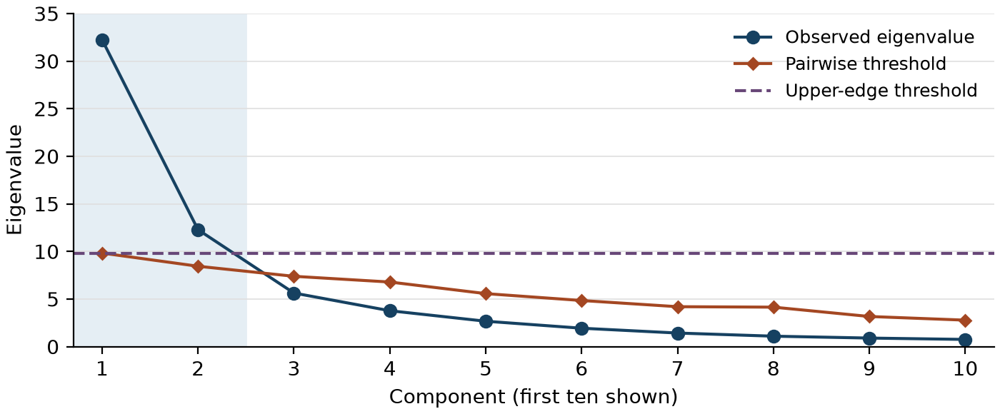

# Selecting 2DPCA components for clothing recognition

This project implements signflip parallel analysis (SPA) for two-dimensional principal component analysis (2DPCA) and evaluates nearest-neighbour recognition on 28 × 28 grayscale Fashion-MNIST images. Li and Kuang developed SPA to pick the number of leading projection directions using training data. The experiment asks how many coefficients that rule retains and how much clothing recognition accuracy they preserve.

## Run the experiment

The recorded run used Python 3.12.14 on macOS arm64. From the project directory:

```bash
python3 -m venv .venv
source .venv/bin/activate
python -m pip install -r requirements.txt
python experiment.py
python verify.py
python plot_results.py
```

`experiment.py` downloads the four original IDX gzip files into `data/` on its first run and verifies their SHA-256 hashes. For offline use, give `experiment.py` and `verify.py` the same `--data-dir` pointing to a directory containing those files. Use `experiment.py --out other_results` to keep the supplied outputs intact, then pass `--results other_results` to the verification and plotting commands. Numerical libraries can produce small platform differences.

## Measure recognition at different feature sizes

We selected 100 images of each category from the official training set for each of three training seeds (41, 42, 43). All three runs used the same 1,000-image test subset, with 100 per category, sampled from the official test set with seed 101. A training subset may overlap another training subset. We divided pixel values by 255 and kept both image dimensions. For each training run, both SPA rules use the same set of 100 signflips, with random seeds 501, 502 and 503 in training-seed order. All split and sign generation uses NumPy's default PCG64 generator.

`spa.py` constructs the column covariance by averaging the centered training image products. Each null replicate flips signs independently on **covariance entries**. The resulting matrix can be nonsymmetric. Following the authors' ORL notebook, the implementation orders the real parts of its general eigenvalues and computes the linear 95th percentile at each rank. Upper-edge uses the first threshold for every comparison. Pairwise uses the threshold at the corresponding rank. Both stop at the first observed eigenvalue at or below its threshold. The variance baselines take the smallest rank reaching their stated cumulative fraction.

For 2DPCA, the recognition features are the original image projected onto the retained column eigenvectors. The 1-NN distance sums the Euclidean distances between corresponding feature columns. Ties go to the first training example in ascending original-index order. Raw pixels use the identity basis. Full 2DPCA rotates into all 28 directions, which can change this column-wise distance even though no coefficients are removed. Labels stratify sampling and identify the nearest training example's class. They do not fit the basis or rank thresholds.

| Method | Directions for seeds 41 / 42 / 43 | Coefficients per image | Test accuracy, mean ± sample SD |
|---|---:|---:|---:|
| SPA upper-edge | 2 / 2 / 2 | 56 | 68.63% ± 1.21 pp |
| SPA pairwise | 2 / 2 / 2 | 56 | 68.63% ± 1.21 pp |
| 90% variance | 9 / 10 / 10 | 252 / 280 / 280 | 74.20% ± 0.98 pp |
| 95% variance | 15 / 15 / 15 | 420 | 73.47% ± 0.75 pp |
| Full 2DPCA | 28 / 28 / 28 | 784 | 72.57% ± 1.15 pp |
| Raw pixels | 28 / 28 / 28 | 784 | 73.00% ± 0.78 pp |

The two SPA rules agreed on every run. They used 56 of the original 784 coefficients per image, with 5.57 percentage points lower mean accuracy than the 90% variance rule. The coefficient count describes the representation length and excludes basis storage. The sample SD describes variation across these three training draws on a common test set.



## Inspect the evidence

- `dataset.py` verifies and reads the original image and label files.
- `spa.py` fits the projection, computes the null spectra and cutoffs, and finds nearest neighbours.
- `experiment.py` samples data, runs all methods and writes the records.
- `results/run_config.json` preserves versions, sampling settings and dataset hashes.
- `results/fit_41.npz`, `fit_42.npz` and `fit_43.npz` store indices, covariance, eigenpairs, individual signflip spectra and thresholds. Indices are zero-based in their respective official split.
- `results/predictions.csv` records the true label, predicted label and nearest training image for each test example and method. `metrics.csv` contains 18 per-run evaluation records. `summary.csv` aggregates the three training draws per method.
- `verify.py` recounts all predictions from their saved training neighbours, recalculates the covariance and eigenpair identities, and independently recomputes 180 nearest neighbours using direct distances. `plot_results.py` redraws the figure from the saved spectra.
- `AI_WORKFLOW.md` records the AI-assisted selection, implementation and checking process.

## Research and data

- Zhaoyuan Li and Yiling Kuang, “SPA: Signflip Parallel Analysis to Optimize the Number of Principal Components in Two-dimensional PCA,” *Journal of Data Science* 24(4), 734–751. First published online 22 November 2024, assigned to the 2026 issue. [Article](https://doi.org/10.6339/24-JDS1158) · [Journal supplement and original author code](https://jds-online.org/journal/JDS/article/1397/info).
- Jian Yang, David Zhang, Alejandro F. Frangi and Jing-yu Yang (2004), “Two-dimensional PCA: A new approach to appearance-based face representation and recognition.” [DOI](https://doi.org/10.1109/TPAMI.2004.1261097).
- Han Xiao, Kashif Rasul and Roland Vollgraf (2017), “Fashion-MNIST: a Novel Image Dataset for Benchmarking Machine Learning Algorithms.” [Official dataset and class labels](https://github.com/zalandoresearch/fashion-mnist).

The recognition code was written for this project. The original image data are distributed by their authors and are fetched separately.
